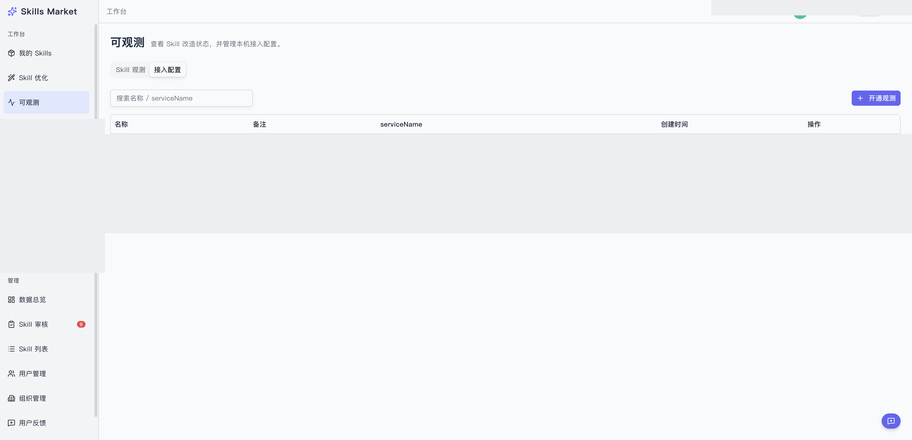

# 开发版（内测）使用文档

> 适用范围：`blueai-skills` CLI 开发版（npm `dev` dist-tag）
> 更新日期：2026-09-28

## 这是什么

开发版把 `develop` 上还没进正式版的改动发布到 npm 的 `dev` dist-tag，供内部同事在真实环境试用。它**不是正式版**：不会替换 `latest`，也不承诺稳定。

开发版与正式版只有两处不同：**默认市场地址**和**命令提示里的 npx tag**。其余行为、本地路径完全一致。

| | 正式版 | 开发版 |
| --- | --- | --- |
| 安装方式 | `npx blueai-skills` / `@latest` | `npx blueai-skills@dev` |
| 市场地址 | 生产 `https://blueai-skills-market.bluemediagroup.cn` | 内网测试 `https://blueai-skills-market.domob-inc.cn` |
| 本地状态 | 见下节 | **与正式版完全相同** |
| 命令提示 | `npx blueai-skills@latest ...` | `npx blueai-skills@dev ...` |

裸安装（`npm i -g blueai-skills`、`npx blueai-skills`）走 `latest`，**不会**装到开发版。

## 测试同事怎么用

### 前置条件

- 能访问内网 `blueai-skills-market.domob-inc.cn`（必要时连 VPN）
- Node.js >= 18
- 需要用 `login` / `publish` / `withdraw` / `obs` 时，准备好对应市场的 API Key

### 运行

```bash
# 确认版本
npx --yes blueai-skills@dev --version

# 运行任意命令（<命令> 换 add / list / find / obs / track ...）
npx --yes blueai-skills@dev <命令>
```

`--yes` 跳过 npx 的首次安装确认，脚本或非交互场景建议带上。

### 回到正式版

```bash
npx --yes blueai-skills@latest <命令>
```

命令本身不需要清理，但**两版共用同一份本地状态**，注意下面一节的影响。

## 与正式版共用本地状态（重要）

| 状态 | 位置 |
| --- | --- |
| API Key | `~/.blueai/secrets.json` |
| 全局安装锁 | `~/.agents/.skill-lock.json`（或 `$XDG_STATE_HOME/skills/.skill-lock.json`） |
| 全局技能目录 | `~/.agents/skills/` |
| Agent 专属目录 | `~/.claude/skills/`、`~/.codex/...`、`~/.openclaw/skills/` 等，按既有规则建立链接或副本 |

因此**开发版安装的技能，Claude / Codex 等真实 agent 可以直接读取和使用**。

代价是两边共用同一份记录，需要知道三件事：

1. **两个市场的 `skillId` 不互通。** 用开发版装（或更新）的技能，其 ID 来自测试市场；之后用正式版跑 `skills check -g`，这些条目会匹配不上。恢复方式是用同名正式技能重装一次。
2. **同名技能互相覆盖。** 开发版装一个技能会覆盖正式版的同名技能，反之亦然。测完记得把正式版本装回来。
3. **登录态共享。** 两个市场用的是同一个 `secrets.json`，切换市场需要重新 `login`，或临时用 `SKILLS_API_KEY=<key>` 指定。

例外：LoongSuite Pilot 使用 `~/.loongsuite-pilot/`，是机器级常驻服务。`obs install` / `obs uninstall` 会真实作用于本机，请在专用机器或虚拟机上验证。

## 测试市场（网页端）

开发版对接的是内网测试市场，除了 CLI，也可以直接在网页上操作：

- 市场入口（工作台）：`https://blueai-skills-market.domob-inc.cn`
  - **我的 Skills**：管理在测试市场创建的私有技能。
  - **可观测**：`https://blueai-skills-market.domob-inc.cn/dashboard/observability`
    - **Skill 观测** 标签：查看 Skill 的改造状态。
    - **接入配置** 标签：管理本机接入记录（名称 / 备注 / serviceName / 创建时间），支持查看命令、查看数据、编辑、删除；右上角「开通观测」可新建接入并拿到安装命令。
    - 这里的接入记录与 CLI 的 `obs <agentName>`、`obs install <agentId>`、`obs list` 操作的是同一批数据，网页和命令行可以互相核对。

网页与 CLI 都需要能访问内网（必要时连 VPN），登录使用测试市场的账号。



上图为「可观测 → 接入配置」的界面（截图中的接入数据行、团队名与右上角身份已脱敏）：左侧进入可观测，右上角「开通观测」新建接入，列表里可对每条接入执行查看命令、查看数据、编辑、删除。

## 环境变量

| 变量 | 作用 | 生效范围 |
| --- | --- | --- |
| `SKILLS_SITE` | 覆盖市场地址，优先级最高 | 开发版 / 正式版都生效 |
| `SKILLS_API_KEY` | 覆盖 API Key，优先于凭证文件 | 开发版 / 正式版都生效 |

```bash
# 临时指向本地 skills-market
SKILLS_SITE=http://localhost:3000 npx --yes blueai-skills@dev obs list

# 临时使用另一套 API Key（切市场时免于重新 login）
SKILLS_API_KEY=sk-xxxx npx --yes blueai-skills@dev whoami
```

早期开发版引入的 `BLUEAI_SKILLS_HOME` 与 `BLUEAI_SKILLS_DEV` 已移除，设置它们不会有任何效果。

## 常见问题

**1. `npx blueai-skills@dev` 报 404 或找不到包**

npm 发布后有校验队列，页面状态是 `Validating` 时还不可安装。等状态变为已发布后重试，或用 `npm view blueai-skills dist-tags` 确认 `dev` 是否已指向新版本。

**2. 拿到的是旧版本**

npx 有本地缓存。先执行 `npx --yes blueai-skills@dev --version` 看实际版本；仍不对时可指定具体版本，或清理缓存 `rm -rf ~/.npm/_npx` 后重试。

**3. 请求市场失败**

开发版默认连内网测试市场，先确认内网可达；需要临时换地址用 `SKILLS_SITE` 覆盖。

**4. 正式版 `check` 对某些技能提示异常**

这些技能是用开发版从测试市场装的，ID 与正式市场不匹配。用同名正式技能重装即可恢复。

**5. 之前用过带状态根的开发版，技能去哪了**

旧的 `~/.blueai-skills-dev/` 目录不再被读取，里面的技能不会自动出现。需要的话在真实路径下重新安装；该目录可以选择手动删除。

## 维护者：发布开发版

```bash
# 0. 切到 develop，工作区必须干净
git checkout develop
git status --porcelain

# 1. 预检（只计算版本与校验，不推标签）
pnpm publish:dev -- --dry-run

# 2. 发布：生成 dev-v<版本> 标签并推送到 GitHub 镜像
pnpm publish:dev
```

执行链路：

1. 脚本按当前 `package.json` 版本推导唯一预发布版本号，并校验该版本在 npm 与远端标签都不存在。
2. 推送 `dev-v<版本>` 标签到 `old-origin`（GitHub 镜像）。
3. `.github/workflows/publish.yml` 收到 `dev-v*` 标签后，以开发版构建目标构建、按标签写入版本号、`npm publish --tag dev`，并跳过 GitHub Release。
4. `latest` 不受影响。

发布后核对：

```bash
gh run list --repo FE-runner/skills --limit 3   # CI 是否成功
npm view blueai-skills dist-tags                # dev / latest 的指向
npx --yes blueai-skills@dev --version           # 真实安装验证
```

注意事项：

- **不要**给 develop 打 `v*` 标签，那会触发正式发布（`--tag latest`）。开发版标签形如 `dev-v*`，两者不重叠。
- npm 版本号不可复用，重试必须生成新版本号；脚本用秒级时间戳加存在性预检保证唯一。

## 相关实现

| 文件 | 职责 |
| --- | --- |
| `scripts/publish-dev.sh` | 开发版发布入口：版本推导、预检、推标签 |
| `.github/workflows/publish.yml` | `dev-v*` / `v*` 分叉构建与发布 |
| `src/paths.ts` | 凭证目录与全局锁路径的单一来源 |
| `src/branding.ts`、`build.config.mjs` | 市场地址与 npx tag 的构建期注入 |
